# orkut

> **Two things to know before you run this.**
>
> **1. There is no admin interface.** There is no site-admin role anywhere in the schema
> or the code, no admin panel, no way to administratively remove a user, suspend an
> account, or globally review content. The one moderation queue at `/moderation` is
> gated on being signed in and nothing more, so *any* registered account can read the
> reports and act on them. That is a simplification for a demo, not a governance model.
>
> **2. This has not been properly security-checked.** The authentication code was written
> with real measures in mind, and several are implemented and exercised: Argon2id, TOTP
> two-factor, per-device sessions, CSRF protection, closed signup enumeration, and
> uploads stored outside `public/`. But no independent party has reviewed any of it,
> there has been no penetration test, and no formal audit has ever been carried out.
> Treat the whole thing as unvetted. The four hosted mail transports (Resend, Postmark,
> SES, SMTP) have likewise never been tested against a live provider API.
>
> **So run it locally.** Do not expose this to the public internet, and do not lift the
> authentication or session code into anything real without an independent security
> review first. The full list of what is implemented and what is merely believed to work
> is under [Security](#security) and [Known differences](#known-differences).

A working recreation of Orkut, the social network Google built in 2004 and closed in
2014. Profiles, scrapbooks, testimonials, communities, crushes, fans, the pink.

Not a UI mockup. A real, running application with a Postgres database, real file
uploads, real authentication, and TOTP two-factor.

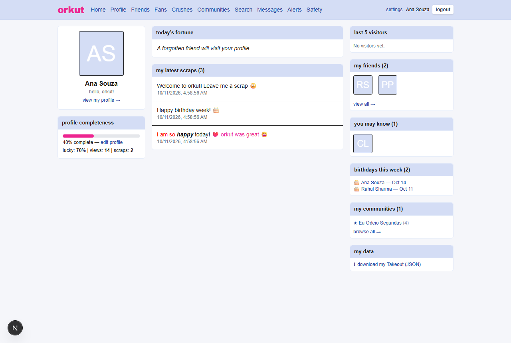

---

## Why Orkut still matters

Orkut is a genuine historical artifact. It was the first social network out of Google,
launched on **24 January 2004**, one month before Facebook. It was created by
**Orkut Büyükkökten**, a Turkish software engineer who had previously built Stanford's
Club Nexus, and named it after himself. It came out of Google's famous **20% time**
program, where engineers spend a fifth of their working time on projects that are not
their job.

What made Orkut different was that it was not private by default. Unlike Facebook, any
profile could be viewed by anyone, and browsing strangers was normal behaviour rather
than a bug. The UI was deliberately plain and low-bandwidth because its audience was
reaching it through cybercafes and early broadband.

The single feature people remember is the **scrapbook**: a short, public, directed
message you could leave on someone's wall, with `[b]bold[/b]`, `[color=red]`, `:D`
smileys, and inline media. It was permanent rather than a stream, it was free rather
than requiring acceptance, and it made talking to someone you had never met feel
effortless. Testimonials were its quieter sibling: a friend wrote you a short
endorsement, and you chose whether to display it.

### The strange geography of it

Orkut did not simply grow. It **inverted**. In March 2004 it was overwhelmingly an
American site. By the day it closed, it had become a Brazilian and Indian product.

| | 31 March 2004 | 30 September 2014 |
|---|---|---|
| United States | **51.4%** | 3.3% |
| Japan | 7.7% | 2.7% |
| Brazil | 5.2% | **55.5%** |
| India | not broken out | **18.4%** |
| China | not broken out | 6.4% |
| Netherlands | 4.1% | not broken out |
| United Kingdom | 3.7% | not broken out |

The 2004 figures are a full breakdown by country; by 2014 the top five accounted for
almost everything and the rest was pooled.

In 2008 Orkut was the most visited site in both Brazil and India, and Google moved its
entire development operation to Belo Horizonte. The theming engine, which shipped on
2 June 2008, was only ever enabled in Brazil and India. Most people outside those two
countries never saw the colourful themes, which is why the modern memory of Orkut is
so aggressively pink.

### Why it died

It was built for a projected 200,000 users and did not scale past a certain kind of
attention. It was also damaged by things it could not control:

- **The W32/KutWormer worm**, 19 December 2007, which spread through the HTML feature
  in scraps and infected more than **700,000 accounts** in days.
- **Hate groups.** A community called "We Hate India" led the Bombay High Court to serve
  Google with notice in October 2006.
- **It never shipped a feed that worked.** "Updates from your friends" (2007) and the
  Google Buzz integration (2010) both failed to reverse the decline.
- **Facebook and mobile simply won.** Google engineering director Paulo Golgher's
  explanation was that "the growth of these communities has outpaced Orkut's growth".

Google announced the closure on 30 June 2014 and shut it on **30 September 2014**.
Takeout export stayed open until September 2016. The domain came back in April 2022, and
as of May 2026 it displays nothing but a letter from the founder.

---

## What this is

A faithful reconstruction of the Orkut of roughly 2006 to 2010: the version that was
actually popular, not the early invite-only version and not the late decline. It keeps
the things that were distinctive about Orkut and drops the ones that were just bad:

**Kept, because they were the point**

- The **scrapbook**, with live preview, BBCode formatting, colour sanitisation, smileys,
  a 1,000 character limit, and per-scrap privacy.
- **Testimonials**, written by friends and accepted or rejected by the recipient.
- **Communities** with forums, polls, events, member lists, owner and moderator roles,
  written rules, and a join policy of open, approval, or closed.
- **Fans** (one-way) kept separate from **friends** (two-way, request and accept), which
  is the distinction Orkut users cared about.
- **Crushes**, secret until they are mutual. The moment of mutual reveal is the whole
  emotional mechanic.
- **Friendship tiers**: acquaintance, good friend, best friend. The best-friend avatar
  gets a pink ring.
- **Orkut ratings**: cool, sexy, trustworthy, rated 1 to 3 on icon scales and shown as a
  percentage, exactly as Orkut aggregated them.
- **Lucky %**, profile completeness, fans, the last 5 visitors, and profile views broken
  into yesterday / last week / all time.
- Five selectable themes.
- **Google Takeout** style JSON export.

**Dropped, on purpose**

A news feed. Orkut shipped one and it did not help. Chat (Orkut delegated that to Google
Talk). OpenSocial apps (5,000 of them were real, but the ecosystem is dead and there is
nothing left to integrate against).

---

## Screenshots

### Profile, scrapbook, and ratings

The scrapbook is the centre of the whole thing. Formatting is rendered from React
nodes, never from injected HTML, so `[color=javascript:...]` degrades to plain text.

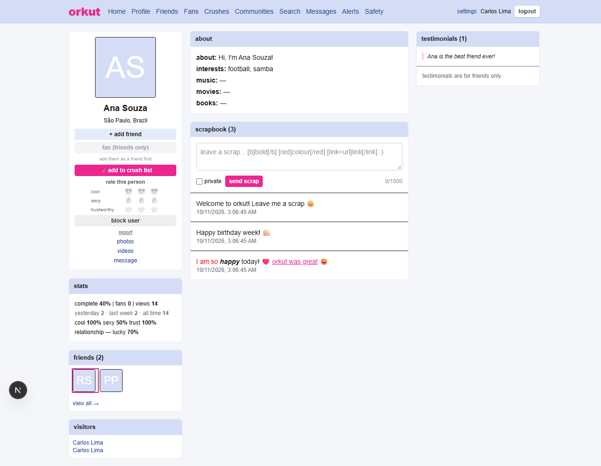

### Home

Fortune cookie, latest scraps, birthdays this week, people you may know, and your
Takeout export.


### Communities

Forum topics, polls with vote enforcement, events with RSVP, and videos, all under one
community.

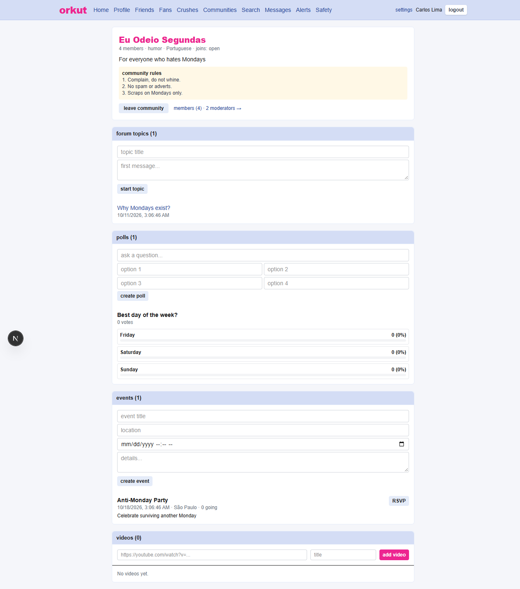

### Community roles

Owners and moderators, with role changes restricted to the owner.

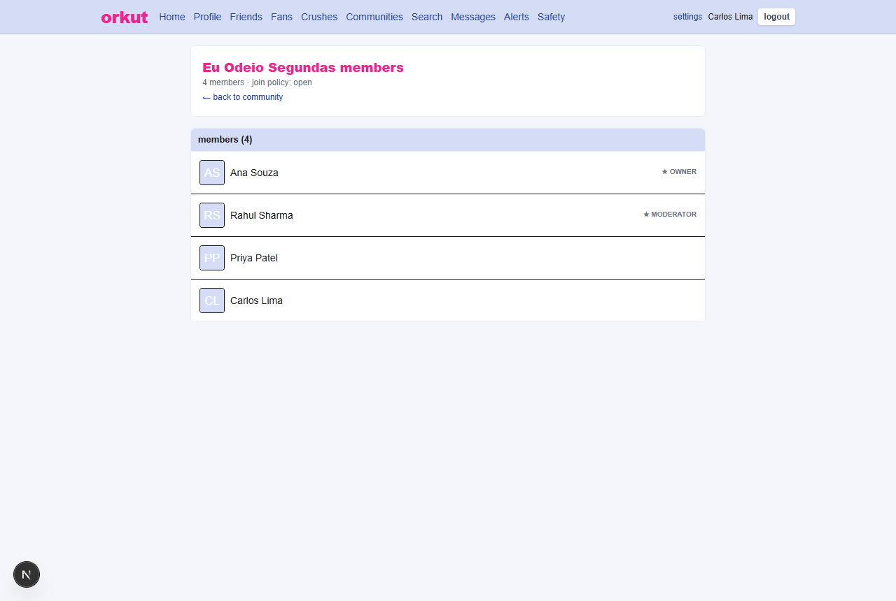

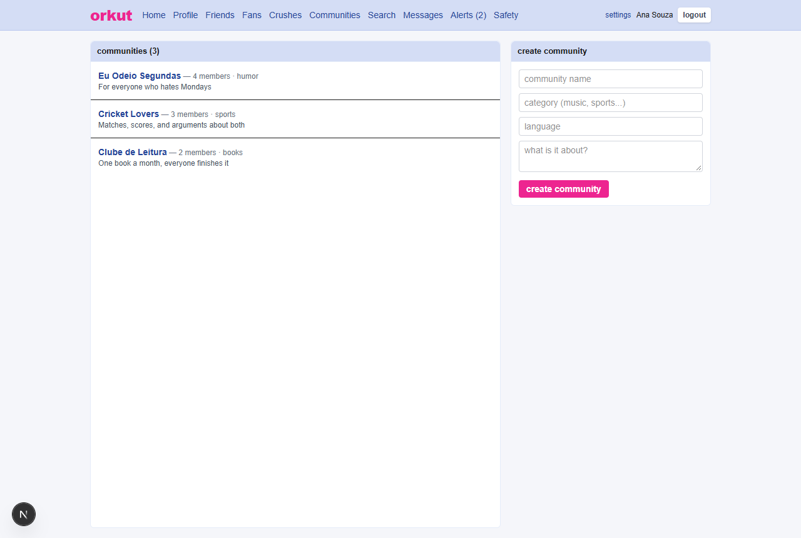

### Friends and fans

Two separate lists, because Orkut treated them as two separate things.

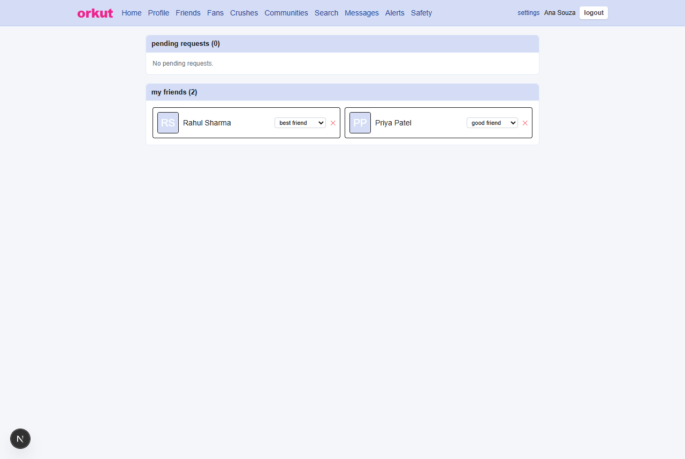

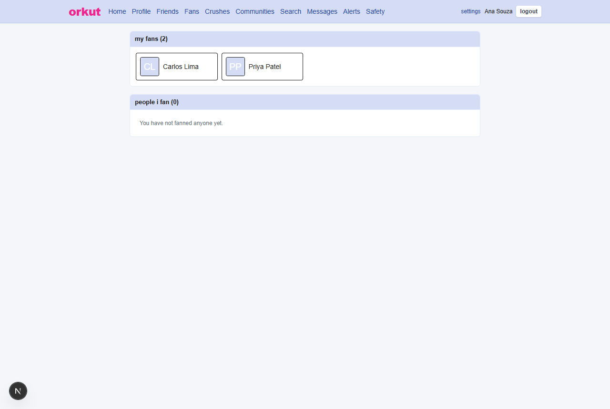

### Crushes

Hidden until mutual.

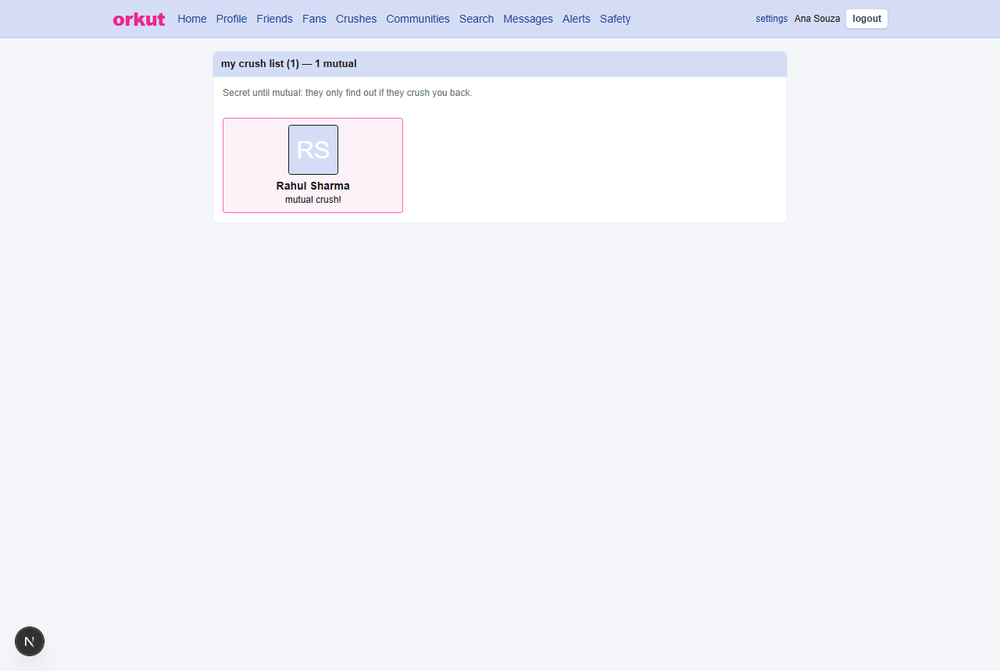

### Photo albums

Albums plus an unfiled bucket, real multipart upload stored outside `public/`.

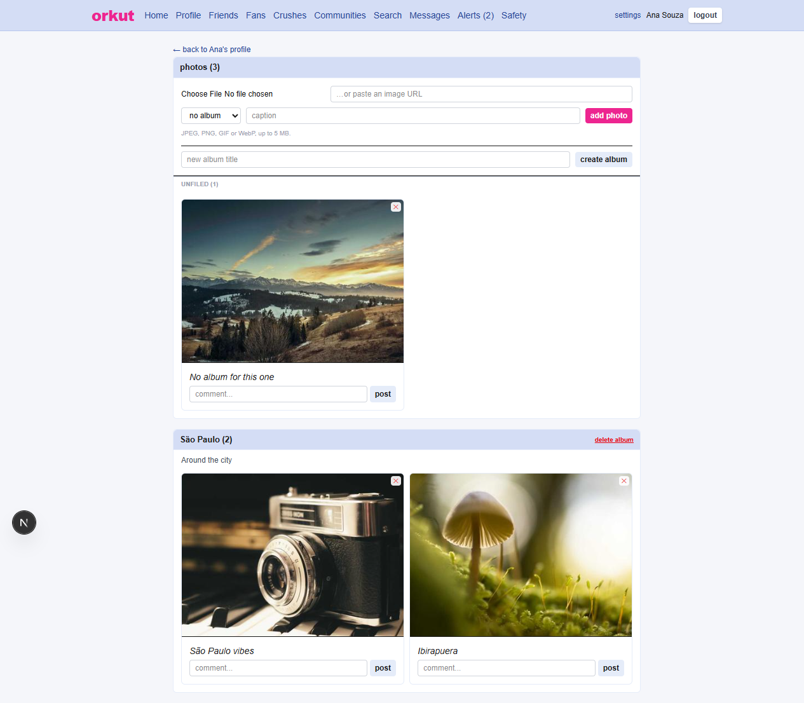

### Notifications

With an unread badge in the nav. Scrap excerpts render through the same formatter as the
scrapbook, so a coloured fragment previews the way it will look.

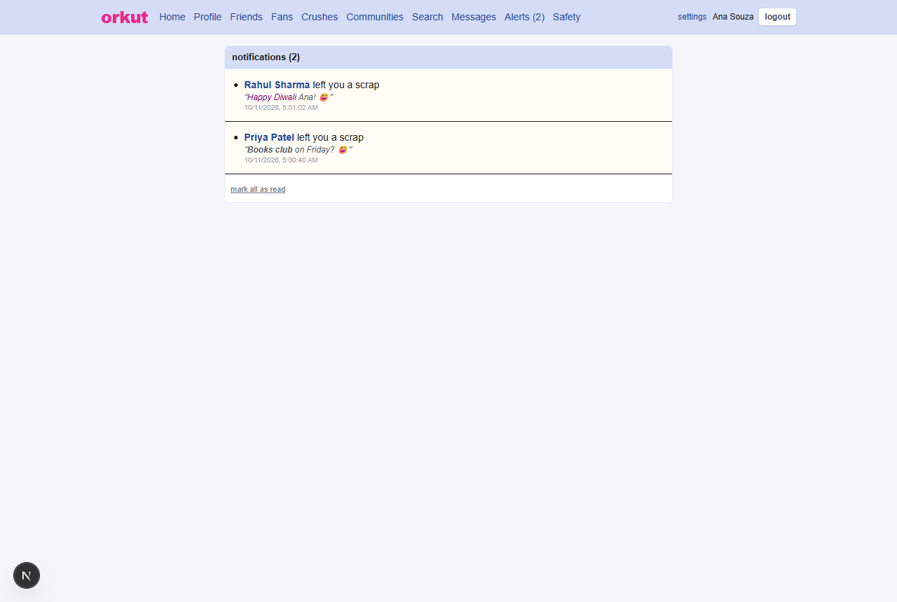

### Safety

Block, report, and a moderation queue that feeds a jail ladder.

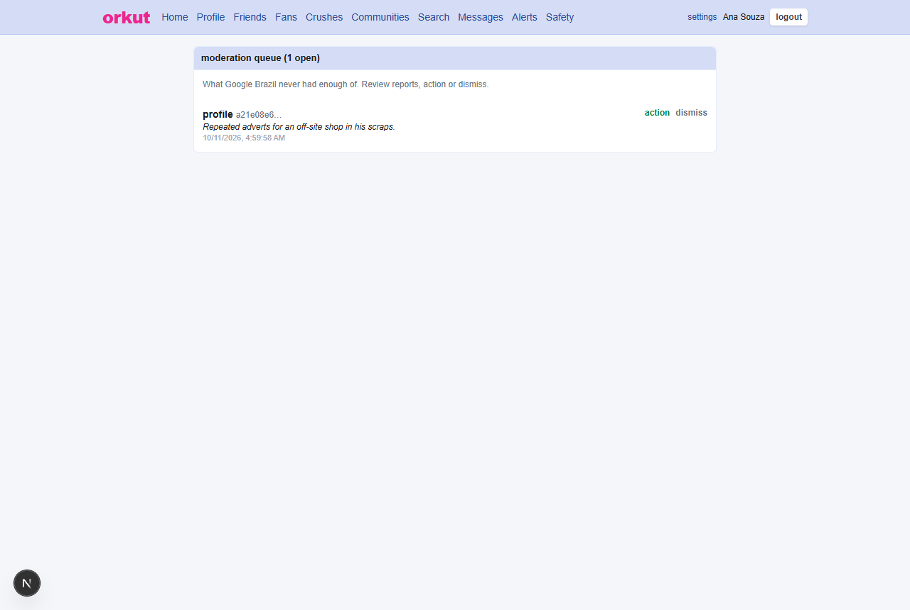

### Settings

Themes, two-factor enrolment, and per-device session management.

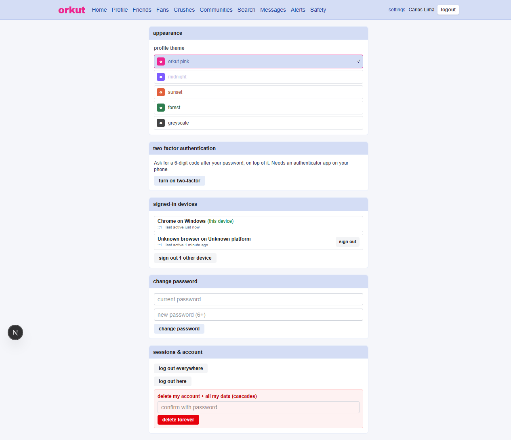

Also: [messages](docs/screenshots/messages.png) and [search](docs/screenshots/search.png).

---

## Stack

| | |
|---|---|
| Framework | Next.js 16, App Router, React 19 |
| Language | TypeScript, strict |
| Database | PostgreSQL 16 in Docker |
| ORM | Drizzle ORM, plain SQL migrations |
| Password hashing | Argon2id via `@node-rs/argon2`, PBKDF2 fallback |
| Two-factor | RFC 6238 TOTP, validated against the published test vectors |
| Styling | Tailwind CSS 4 with CSS-variable themes |

---

## Running it

Requires Node 24+ and Docker.

```bash
git clone <this repo>
cd orkut
cp .env.example .env          # then set AUTH_SECRET to something long and random
docker compose up -d          # Postgres on :5432

# Apply the migrations. The order matters: migrate-p3.sql alters the photos
# table, which migrate-option-a.sql creates, and migrate.sql has to be first
# because everything else references users. This exact sequence was verified by
# building a scratch database from empty and diffing the result against a live
# one: 177 columns, identical.
for f in migrate.sql migrate-polls.sql migrate-option-a.sql migrate-final.sql \
         migrate-safety.sql migrate-rate-limits.sql migrate-orkut-fidelity.sql \
         migrate-p3.sql migrate-email-verification.sql migrate-p44.sql; do
  docker exec -i orkut-db-1 psql -U orkut -d orkut -v ON_ERROR_STOP=1 < "$f"
done

npm install
npm run dev                   # http://localhost:3000
```

Then seed the demo data:

```bash
curl http://localhost:3000/api/seed
```

The seed is idempotent: it clears and rebuilds its own content, and running it twice
does not duplicate anything.

### Demo accounts

| Email | Password |
|---|---|
| `ana@example.com` | `orkut123` |
| `rahul@example.com` | `orkut123` |
| `priya@example.com` | `orkut123` |
| `carlos@example.com` | `orkut123` |

Signing up requires email verification. The default `console` mail provider prints the
verification link to the server log rather than sending it, which is why the signup
response also returns a `devVerificationLink` field in development. That provider
refuses to run in production.

---

## Configuration

| Variable | Required | Notes |
|---|---|---|
| `DATABASE_URL` | yes | Postgres connection string |
| `AUTH_SECRET` | yes | Signs two-factor challenges and derives the TOTP key |
| `APP_URL` | yes | Base URL used to build email verification links |
| `MAIL_PROVIDER` | no | `console` (default), `resend`, `postmark`, `ses`, `smtp` |
| `TOTP_ENCRYPTION_KEY` | no | 32 bytes as hex or base64. **Set this in production.** |
| `REQUIRE_EMAIL_VERIFICATION` | no | Defaults to on |
| `UPLOAD_DIR` | no | Where uploaded photos are written. Defaults to `./data/uploads` |

If `TOTP_ENCRYPTION_KEY` is unset, the AES-256-GCM key for TOTP secrets is derived from
`AUTH_SECRET`. That works, but it means rotating `AUTH_SECRET` invalidates every
enrolled authenticator. Set the dedicated key in production.

### Mail transports

`MAIL_PROVIDER` selects the transport. Each one reads its own credentials:

| Provider | Credentials | Dependency |
|---|---|---|
| `console` | none | none. Development only, refused in production. |
| `resend` | `RESEND_API_KEY` | none, uses `fetch` |
| `postmark` | `POSTMARK_SERVER_TOKEN` | none, uses `fetch` |
| `ses` | `AWS_REGION` plus AWS credentials | `@aws-sdk/client-sesv2` |
| `smtp` | `SMTP_HOST`, optional port, user, password | `nodemailer` |

If `MAIL_PROVIDER` is unset, the first transport with usable credentials is inferred, so
dropping in one API key is enough without also setting the selector. An unrecognised
value for `MAIL_PROVIDER` is an error rather than a silent fallback.

---

## Verification

```bash
npx tsc --noEmit     # types
npm run lint         # eslint
npm run verify       # TOTP + password hashing test suites
```

`npm run verify` runs 93 checks with no test framework. The TOTP suite validates against
all 10 RFC 4226 HOTP vectors and all 18 RFC 6238 TOTP vectors across SHA1, SHA256, and
SHA512, plus encryption, tamper detection, and key resolution. The password suite covers
format, verification, fail-closed behaviour on malformed stored values, and the rehash
policy.

---

## Project layout

```
app/                 routes, one folder per page
  api/auth/          login, signup, resend, two-factor
  uploads/[name]/    serves uploaded photos, with traversal and MIME checks
components/          React components
drizzle/schema.ts    the entire data model
lib/                 domain logic, all testable without Next.js
  totp.ts            RFC 6238
  password-hasher.ts Argon2id with PBKDF2 fallback
  scrap-format.ts    the BBCode parser, returns React nodes
  csrf.ts            origin and double-submit checks
  session.ts         per-device session management
scripts/             verification suites
migrate-*.sql        schema, applied in filename order
docs/screenshots/    the images in this README
```

`lib/` is kept free of `next/headers` wherever it can be, so the interesting logic runs
under plain Node without a framework.

---

## Security

Beyond the obvious:

- **Signup enumeration is closed.** Every signup gets an identical response, and the
  timing gap between registered and unregistered addresses was measured and balanced to
  within noise.
- **Login is throttled per IP and per account**, before any validation, so short or
  malformed guesses cannot bypass the budget.
- **Argon2id** with a transparent upgrade: old PBKDF2 hashes still verify and are
  rewritten on the user's next successful login, so nobody is locked out.
- **TOTP secrets are encrypted at rest** with AES-256-GCM. They have to be recoverable,
  which rules out hashing them, so a database dump alone is not enough to impersonate
  an account.
- **Replay protection** on two-factor codes, so a captured code dies at 30 seconds
  instead of 90.
- **Recovery codes**, because without them a lost phone is a dead account.
- **CSRF** on the hand-written API routes, via origin checking plus a double-submit
  token.
- **Uploads are stored outside `public/`** and served by a route that rejects traversal
  and non-image MIME types.

---

## Known differences

Stated plainly rather than left to be discovered:

- **No OpenSocial app container.** The apps were a big part of the original homepage,
  but the ecosystem no longer exists to integrate against.
- **No QR code** for two-factor setup. The `otpauth://` URI is shown as selectable text,
  which every authenticator app accepts.
- **The four hosted mail transports are untested against live APIs.** Provider selection,
  dispatch, and failure handling are proven; actually delivering mail needs real
  credentials for each.
- **`/api/seed` writes on GET.** It refuses to run in production, which is the real
  mitigation, but a state-changing GET is the wrong shape.
- **Visitors can repeat.** The last-5-visitors list is keyed on the visit, so visiting
  someone twice shows them twice.

---

## Sources

- [Orkut, Wikipedia](http://en.wikipedia.org/wiki/Orkut)
- [Google finally decides to abandon Orkut, Ars Technica](https://arstechnica.com/information-technology/2014/06/google-finally-decides-to-abandon-orkut)
- [Google to shut down its first social network, TechSpot](https://www.techspot.com/news/57271-google-to-shut-down-its-first-social-network-on-september-30.html)
- [Google is killing off Orkut, NBC News](https://www.nbcnews.com/tech/social-media/google-killing-orkut-its-social-network-you-dont-remember-n144426)
- [Google Finally Shuts Down Orkut, Forbes](https://forbes.com/sites/ellenhuet/2014/06/30/google-kills-orkut)
- [Orkut shuts down, Yahoo Finance](https://finance.yahoo.com/news/google-orkut-shuts-down-today-190207606.html)

---

Not affiliated with Google. Orkut is a trademark of its respective owner. This is a
tribute built for nostalgia and for the study of how social networks were actually
designed before the feed took over.